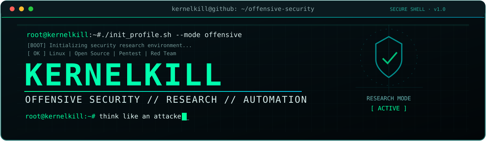
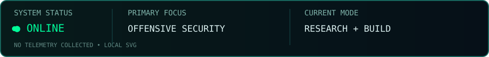
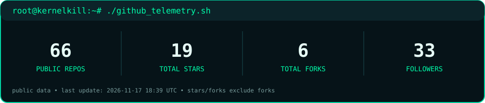

<div align="center">





<br />

[](https://kachorroskicyber.com)
[](https://github.com/kernelkill)
[](https://bugcrowd.com/h/kernelkill)
[](https://github.com/kernelkill/CaidoAIDriven)

</div>

<div align="center">



</div>

## `root@kernelkill:~# whoami`

```text
┌──(kernelkill㉿offensive-security)-[~]
└─$ cat /etc/profile.d/about.conf

NAME       : Joabe Kachorroski
HANDLE     : kernelkill
ROLE       : Cybersecurity Researcher | Security Engineer | Pentester
FOCUS      : Offensive Security, Red Team, AppSec, API Security
LOCATION   : Campo Grande - MS, Brazil
PHILOSOPHY : Think like an attacker. Defend like an engineer.

[+] Security research, vulnerability discovery and responsible disclosure
[+] Web application, API and infrastructure security assessments
[+] Fortinet and F5 security engineering
[+] Open source, Linux and security automation
[+] Building AI-assisted pentesting workflows
```

> **Hello, world.** Trabalho com segurança ofensiva e defensiva, pesquisa de vulnerabilidades e automação de segurança. Gosto de transformar pesquisa técnica em ferramentas práticas, compartilhar conhecimento e contribuir com a comunidade de segurança.

## `root@kernelkill:~# cat /var/log/recognitions.log`

```text
[RECOGNITION] NASA  :: Security vulnerability reported responsibly
[RECOGNITION] GLOBO :: Security Hall of Fame
[COMMUNITY]   SHC   :: Sucuri Hacker Club / Community activities
[EDUCATION]         :: Technology and cybersecurity instructor
```

- **NASA:** reconhecimento por reporte responsável de vulnerabilidade de segurança (SQL Injection, criticidade P1).
- **Globo:** reconhecimento no programa de segurança / Hall of Fame.
- **Comunidade:** atividades técnicas, eventos e compartilhamento de conhecimento em cybersecurity.

> Os reconhecimentos se referem a pesquisas e reportes de segurança e **não representam vínculo ou endosso** das organizações.

## `root@kernelkill:~# cat certifications.txt`

```text
[+] CompTIA PenTest+
[+] Certified Secure Computer User (CSCU)
[+] Certified Network Security Practitioner (CNSP)
[+] API Red Team Analyst (API-RTA)
```

## `root@kernelkill:~# ./enumerate_skills.sh`

| Domain | Tools / Technologies |
|:--|:--|
| **Offensive Security** | Pentest · Red Team · Bug Bounty · Vulnerability Research |
| **Application Security** | OWASP · Web Security · API Security · Access Control · Authentication |
| **Assessment** | Burp Suite · Caido · Postman · Nmap · Nessus · OpenVAS |
| **Network & Defense** | FortiGate · FortiManager · FortiAnalyzer · F5 BIG-IP / Advanced WAF |
| **Engineering** | Linux · Python · Bash · Docker · Git · Automation |
| **Security R&D** | Adversary Emulation · MITRE ATT&CK · AI-assisted Security Testing |

<div align="center">


</div>

## `root@kernelkill:~# ls -la ~/projects`

### `01 // CaidoAIDriven`

**AI-assisted offensive security environment** — integração de Claude Code, Caido MCP, skills e agentes especializados para apoiar o fluxo de pentest, do reconhecimento à documentação dos achados.

**[→ Explore o repositório CaidoAIDriven](https://github.com/kernelkill/CaidoAIDriven)**

### `02 // Security research & tooling`

Pesquisa prática em segurança de aplicações, APIs e infraestrutura, com foco em automação, validação de vulnerabilidades e experimentação em laboratório.

**[→ Explore meus repositórios](https://github.com/kernelkill?tab=repositories)**

Projetos em desenvolvimento, como ferramentas internas e experimentos de pesquisa, são apresentados aqui sem sugerir que já tenham repositórios públicos.

### `03 // Community & knowledge sharing`

Conteúdo técnico, apresentações e iniciativas voltadas à comunidade de segurança, ao ensino e à troca de experiências em Linux, AppSec e Offensive Security.

**[→ Site pessoal](https://kachorroskicyber.com)**

## `root@kernelkill:~# ./github_telemetry.sh`

<div align="center">

<!-- Generated daily by .github/workflows/profile-metrics.yml and stored in this repository. -->


</div>

<sub>Telemetry includes public repositories, stars and forks (excluding forked repositories), and followers. Updated by GitHub Actions; this is not a live visitor tracker.</sub>

<details>
<summary><b>root@kernelkill:~# cat mission.txt</b></summary>

```text
MISSION
-------
01. Keep learning.
02. Research responsibly.
03. Build tools that help defenders and researchers.
04. Share knowledge with the security community.
05. Make security measurable, repeatable and useful.
```

</details>

---

<div align="center">

**`root@kernelkill:~# exit`**

`[ session closed // keep hacking ethically ]`

<sub>Made with Linux, curiosity and caffeine · © kernelkill</sub>

</div>
